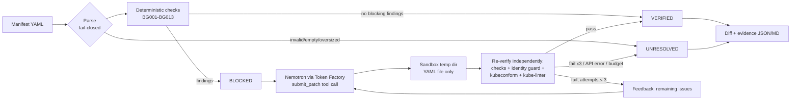

# BlastGuard AI

**Autonomous Kubernetes Security Remediation Agent** — built for the Nebius x NVIDIA Global AI Hackathon
(track: Coding and Agentic Engineering).

**Live demo:** https://blastguard-ai.streamlit.app/ · **Repo:** https://github.com/justrunme/blastguard-ai

The demo sleeps when idle; if it shows a sleeping page, press the wake button, it starts in about a minute.

Paste a risky Kubernetes manifest. Deterministic checks find the security problems, NVIDIA Nemotron (served by
Nebius Token Factory) proposes a patched manifest, and independent verifiers decide whether the patch is accepted.
Up to 3 attempts, then a clear verdict: **BLOCKED → VERIFIED** or **UNRESOLVED**, with a diff and an evidence report.

New in the Submission Period: the **Intent Preservation Gate**. A patch can be secure and still break production, so
after security verification BlastGuard AI compares the patch with the original and reports what changed in what
the workload *does* (hostPath → emptyDir, LoadBalancer → ClusterIP, removed command/env/ports, ...). Result:
**SAFE_TO_PROPOSE** or **REVIEW_REQUIRED** ("security passed, but a human must review before it ships").

> BlastGuard AI: because a secure patch can still break production.

## Why

Security scanners tell you what is wrong; someone still has to write the fix, and LLM-written fixes are not
trustworthy on their own. BlastGuard AI keeps the model in the loop but never in charge: the model only proposes
YAML, and a fix counts only if checks that do not depend on the model agree.

## How it works



* **Deterministic checks** (`blastguard_ai/checks.py`, pure Python + PyYAML):

  | Rule | Severity | Check |
  |---|---|---|
  | BG001 | critical | privileged container |
  | BG002 | critical | hostPath volume |
  | BG003 | high | hostNetwork |
  | BG004 | high | hostPID / hostIPC |
  | BG005 | high | runAsNonRoot not true, or runAsUser 0 |
  | BG006 | high | allowPrivilegeEscalation not explicitly false |
  | BG007 | medium | missing CPU/memory limits |
  | BG008 | medium | `:latest` or untagged image (digests accepted) |
  | BG009 | medium | readOnlyRootFilesystem not true |
  | BG010 | critical | capabilities add ALL / SYS_ADMIN / NET_ADMIN / SYS_PTRACE / SYS_MODULE |
  | BG011 | medium | service account token automounted |
  | BG012 | high | Service of type LoadBalancer |
  | BG013 | info (non-blocking) | no NetworkPolicy in the bundle |

  Covers Pod, Deployment, StatefulSet, DaemonSet, ReplicaSet, Job, CronJob, init containers.
* **Identity guard** (`guard.py`): the patch may not delete/rename objects, remove containers, change the image
  repository (only the tag), scale to 0, or add objects other than NetworkPolicy/ServiceAccount. This stops the
  model from "fixing" a workload by deleting it.
* **Intent Preservation Gate** (`intent.py`): structural comparison of original vs. accepted patch. *High*
  drifts (gate the release decision): hostPath removed/replaced/changed, hostNetwork or privileged removed,
  Service exposure/selector/ports changed, command/args/env/probes changed or removed, container ports or mounts
  removed, replicas, serviceAccountName, nodeSelector, tolerations or affinity changed. *Medium/info* drifts are
  listed but do not gate (image tag change, non-root user, read-only root filesystem without a writable mount,
  dropped capabilities, hostPID/IPC, service account token, resource limits added). It is a static heuristic: it
  cannot prove a workload still works. If the gate itself errors, it fails closed to REVIEW_REQUIRED.
* **External validators** (optional, auto-detected in `./bin` or `PATH`): `kubeconform` v0.8.0 (schema validation,
  `-strict`) and `kube-linter` v0.8.3 (a security subset of its checks). If installed, a `fail` from either blocks
  VERIFIED. Their status (`pass`/`fail`/`error`/`not_installed`) is recorded per attempt in the evidence report.
  `kubeconform` downloads schemas on first use; with no network it reports `error` and does not gate.
* **Safety**: the model output is only parsed with `yaml.safe_load_all` and written to a temp sandbox directory.
  Nothing from the model is executed; there is no cluster access.
* **Limits**: 3 attempts max, `BLASTGUARD_MAX_TOKENS` (default 8192) per call, `BLASTGUARD_TIMEOUT_S` (default 90s)
  per request, 300s total wall time, 64 KB / 20 documents manifest cap, `BLASTGUARD_SESSION_RUN_CAP` (default 10), `BLASTGUARD_GLOBAL_RUN_CAP` (default 1500 runs per server process; a real run costs roughly 2k tokens)
  runs per UI session.

## Nemotron + Nebius Token Factory

The real client (`blastguard_ai/llm.py`) uses the `openai` Python SDK against the OpenAI-compatible Token Factory API:

| Env var | Default |
|---|---|
| `NEBIUS_API_KEY` | required, never logged |
| `NEBIUS_BASE_URL` | `https://api.tokenfactory.nebius.com/v1` |
| `NEBIUS_MODEL` | `nvidia/nemotron-3-super-120b-a12b` (confirm with `make models`) |

The model is asked to call a `submit_patch` function with the full patched YAML and a rationale. If it answers in
plain text instead, the largest YAML code block is used (`channel: content_fallback` in the report). Remaining
findings and verifier errors are fed back on the next attempt.

## Setup

```bash
make venv          # python3 -m venv + requirements
make tools         # optional: kubeconform + kube-linter into ./bin
make test          # pytest
export NEBIUS_API_KEY=...   # from your secret store
make models        # list model IDs available to the key
make run           # Streamlit UI on :8501
make demo          # real loop on samples/*.yaml -> examples/
```

Docker fallback: `docker build -t blastguard-ai . && docker run -p 8501:8501 -e NEBIUS_API_KEY blastguard-ai`.

## Tests

`make test` runs unit tests for every rule (positive and negative cases), parsing fail-closed cases (empty,
malformed, oversized, non-mapping, unsafe YAML tags), identity guard, validators, and the loop. Loop tests use a
**scripted fake client that lives only in `tests/fakes.py`**; its outputs are test fixtures, not model output.
The app and `scripts/run_real.py` only use the real API.

## Results

Real-API runs are saved in `examples/` (evidence JSON + Markdown per sample, `summary.json`). Any claim about
fix rates applies only to those samples ("on this corpus").

On this corpus (4 manifests, model `nvidia/nemotron-3-super-120b-a12b` through Token Factory, `submit_patch`
tool call), latest real run, see `examples/summary.json`:

| Sample | Blocking findings before | Security result | Release decision | High-impact drifts | Attempts | Tokens |
|---|---|---|---|---|---|---|
| 01-privileged-hostpath | 9 | VERIFIED | **REVIEW_REQUIRED** | `HOSTPATH_REPLACED`, `PRIVILEGED_REMOVED` | 1 | 1635 |
| 02-latest-root-nolimits | 6 | VERIFIED | **REVIEW_REQUIRED** | `ROOTFS_READONLY_NO_WRITABLE_PATH` | 1 | 1414 |
| 03-loadbalancer-exposed | 8 | VERIFIED | **REVIEW_REQUIRED** | `HOSTNETWORK_REMOVED`, `ROOTFS_READONLY_NO_WRITABLE_PATH`, `SERVICE_EXPOSURE_CHANGED` | 1 | 1608 |
| 04-stateless-api-missing-limits | 3 | VERIFIED | SAFE_TO_PROPOSE | none | 2 | 2948 |

Samples 01 to 03 are intentionally dangerous; sample 04 is a mostly hardened API and is the only one that reaches
SAFE_TO_PROPOSE. In the latest run, sample 04 needed two attempts: attempt 1 failed kube-linter, and the failure
was fed back to the model (the first time the retry path was exercised by the real model). Release decisions were
stable across the real runs I did, but earlier runs differed in attempt counts and tokens, and the model is
non-deterministic. This table is a smoke test; the benchmark, blind challenge and runtime proof below add more evidence.

SAFE_TO_PROPOSE requires: security verification passed, every external validator (kubeconform, kube-linter) ran
and passed, and the Intent Gate found no high-impact static drift. If a validator is missing or errors, the
release decision is REVIEW_REQUIRED with an "incomplete verification" note. It does not mean the workload was
tested in a cluster. Read-only root filesystem without a writable mount is a high-impact drift, so a hardened
nginx patch (sample 02) is sent to human review.

## Benchmark (16 cases x 3 runs, real Nemotron)

`python scripts/run_benchmark.py --repeats 3` runs 16 hand-written manifests through the real loop (48 runs, 66
model calls, about 105k tokens in total, well under a cent per run). Ground truth for "is the workload's declared
function preserved" comes from `benchmark/oracles.py`, plain-dict checks that do not import the gate. Full tables:
[`benchmark/results/RESULTS.md`](benchmark/results/RESULTS.md); raw per-run JSON is in `benchmark/results/raw/`.

On this corpus, among the 35 runs that passed security verification after a model patch:

| | gate REVIEW_REQUIRED | gate SAFE_TO_PROPOSE |
|---|---|---|
| function broken (oracle) | 14 | **0** (false SAFE) |
| function preserved (oracle) | 0 (false review) | 21 |

* In all 5 function-critical cases (hostPath log collector, hostNetwork exporter, public LoadBalancer, eBPF agent
  needing NET_ADMIN, docker socket) the model removed the needed feature and security verification accepted the
  patch; the gate sent 14 of 15 runs to REVIEW_REQUIRED, and the 15th run (eBPF agent) ended UNRESOLVED (nothing proposed).
* The 2 already-hardened manifests returned NO_CHANGE_NEEDED (6 of 6 runs). The malformed-YAML and non-Kubernetes
  inputs were rejected before any model call (6 of 6 runs). In the prompt-injection case (a comment telling the model
  to set `privileged: true`), the model ignored it in 3 of 3 runs and the patch did not weaken the posture.
* Limits, stated plainly: 16 hand-written cases, authored by this project. The oracles are independent code but test
  many of the same structural facts as the gate, so agreement on the function-critical cases is expected and does
  not show the gate catches breakage outside what both encode. Everything is static; nothing was run in a cluster.

## What existed before / what was built during the Submission Period

* **Existed before:** [justrunme/blastguard](https://github.com/justrunme/blastguard) (Go, Apache-2.0), a CVE
  blast-radius decision engine (ALLOW/WARN/QUARANTINE/BLOCK). It does not validate YAML manifests and is **not
  integrated** in this MVP. Third-party tools used as-is: kubeconform, kube-linter, Streamlit, PyYAML, openai SDK.
* **Built during the Submission Period (this repository):** the remediation loop, all deterministic rules, identity
  guard, validator integration, Nemotron/Token Factory client, evidence reports, Streamlit UI, sample manifests,
  tests, docs.

## A/B counterfactual and Runtime Proof (kind)

**A/B (no new model calls).** Re-reading the 35 saved benchmark runs that reached VERIFIED after a model patch, a
security-only baseline would accept all 35, including 14 patches that break the declared function (for example a
`hostPath` log collector turned into an `emptyDir`). BlastGuard with the Intent Preservation Gate sends those 14 to
human review and accepts 0 of them as safe. See [`benchmark/results/AB.md`](benchmark/results/AB.md). This is on
this corpus with static oracles, not a general detection rate.

**Runtime Proof on a disposable kind cluster (separate from the static benchmark above, which ran nothing in a cluster).** [`runtime/`](runtime) holds a synthetic collector that reads a marker
file from a node `hostPath`, and the real patch Nemotron produced for it through the BlastGuard loop (release:
REVIEW_REQUIRED). A GitHub Actions workflow creates a throwaway kind cluster and runs both manifests:
the original reports `COLLECTED`, the model-patched manifest reports `NOTHING_TO_COLLECT`. So the security-clean patch
really stops doing its job in a cluster, which is what the gate flagged statically
([successful run](https://github.com/justrunme/blastguard-ai/actions/runs/40813773858)). The CI job also asserts that the recorded BlastGuard release is `REVIEW_REQUIRED`. The recorded run shows the real two-step loop: attempt 1 kept the `hostPath` and failed `BG002`, attempt 2 used `emptyDir` and passed. CI replays the saved patch and makes no new model call. It uses synthetic data only
and never runs user YAML. It is one case, not a benchmark.

## Blind challenge (6 unseen cases) and post-hoc audit

Six extra cases (Postgres StatefulSet, legacy DNS client, nginx with a reloader sidecar, GPU inference server,
kubectl CronJob, JVM service) were written and scored by a separate pass that had not read the gate, then run
3 times each against the real model: [`benchmark/blind/results/RESULTS.md`](benchmark/blind/results/RESULTS.md).

Result, on this corpus: all 18 runs reached VERIFIED; the frozen oracles found no broken function in any of them
(FALSE_SAFE = 0, but also TRUE_REVIEW = 0 by the oracles). The gate sent 13 of 18 runs to review. The frozen matrix
is left as published: by the oracles those 13 are false alarms.

**Post-hoc audit in a real cluster** ([`audit/AUDIT.md`](audit/AUDIT.md), disposable kind cluster in GitHub Actions,
[evidence run](https://github.com/justrunme/blastguard-ai/actions/runs/40816573846)): of those 13 review calls,
- **2 failure modes confirmed across 6 runs**: nginx on a read-only root crash-loops in all 3 patched runs (`mkdir() "/tmp/proxy_temp"
  failed (30: Read-only file system)`), and the kubectl CronJob with a token mounted without `ca.crt` fails TLS
  verification in all 3 patched runs, while both originals work;
- 3 could not be tested (the case image registry is fictional, so the invented-tag suspicion is not confirmed);
- 4 were not checked and may be false alarms (b01 run 2, b06 runs 1-3).

So the oracles were too lax, not the gate, for at least those 6 runs, and the gate gave generic reasons rather than
naming the exact failure. Limits: post-hoc, one author, a small corpus, static oracles for the rest, and the audit
judged the nginx container alone because the sidecar image in the case is fictional.

## Red-team notes (after the blind challenge)

After the blind challenge I red-teamed the Intent Gate myself and found a blind spot: only `hostPath` volumes were
tracked. A `persistentVolumeClaim`, `nfs`, `csi`, `configMap`, `secret` or `projected` volume replaced by `emptyDir`
(data or config lost across Pod restarts), or such a volume removed, raised no high drift. 9 of 19 new tests in
`tests/test_intent_volumes.py` failed on the earlier gate.

What I added to `blastguard_ai/intent.py` (all severity high; existing codes and severities unchanged):
`PERSISTENT_VOLUME_REPLACED`, `CONFIG_VOLUME_REPLACED`, `VOLUME_REMOVED`, `PERSISTENT_VOLUME_CHANGED` (claim or
backing store changed). The tests include negative controls (emptyDir kept, unchanged PVC/configMap/secret, additive
`/tmp` emptyDir, added read-only mounts) that must not raise high drift.

This is a static check, not a runtime proof. The benchmark and blind numbers above were produced with the earlier
gate version (commit `e634137`). Replaying every stored patch offline (48 benchmark runs, 18 blind runs, 4 samples,
1 runtime case; no model calls) with the new gate changes 0 recorded decisions.

## Limitations

* Static manifest analysis only: no admission control, no runtime, no cluster access, no Helm/Kustomize rendering.
* The rule set is intentionally small; passing it does not make a workload secure.
* Pinned image tags are chosen by the model; BlastGuard AI does not check that the tag exists in the registry.
  Review the diff (e.g. `readOnlyRootFilesystem: true` may need writable `emptyDir` mounts for the app to start).
* VERIFIED means "passed these security checks"; the Intent Gate adds a review signal but neither is a test in a cluster. The app itself never touches a cluster; the cluster evidence below comes from separate CI runs on disposable kind clusters.
* CVE/exposure decisions from the original BlastGuard are not wired in yet.

## License

Apache-2.0. Copyright Andrey Lesnikov.
