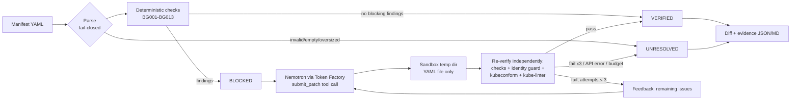

# BlastGuard AI

**Autonomous Kubernetes Security Remediation Agent** — built for the Nebius x NVIDIA Global AI Hackathon
(track: Coding and Agentic Engineering).

**Live demo:** https://blastguard-ai.streamlit.app/ · **Repo:** https://github.com/justrunme/blastguard-ai

Paste a risky Kubernetes manifest. Deterministic checks find the security problems, NVIDIA Nemotron (served by
Nebius Token Factory) proposes a patched manifest, and independent verifiers decide whether the patch is accepted.
Up to 3 attempts, then a clear verdict: **BLOCKED → VERIFIED** or **UNRESOLVED**, with a diff and an evidence report.

## Why

Security scanners tell you what is wrong; someone still has to write the fix, and LLM-written fixes are not
trustworthy on their own. BlastGuard AI keeps the model in the loop but never in charge: the model only proposes
YAML, and a fix counts only if checks that do not depend on the model agree.

## How it works



* **Deterministic checks** (`blastguard_ai/checks.py`, pure Python + PyYAML):

  | Rule | Severity | Check |
  |---|---|---|
  | BG001 | critical | privileged container |
  | BG002 | critical | hostPath volume |
  | BG003 | high | hostNetwork |
  | BG004 | high | hostPID / hostIPC |
  | BG005 | high | runAsNonRoot not true, or runAsUser 0 |
  | BG006 | high | allowPrivilegeEscalation not explicitly false |
  | BG007 | medium | missing CPU/memory limits |
  | BG008 | medium | `:latest` or untagged image (digests accepted) |
  | BG009 | medium | readOnlyRootFilesystem not true |
  | BG010 | critical | capabilities add ALL / SYS_ADMIN / NET_ADMIN / SYS_PTRACE / SYS_MODULE |
  | BG011 | medium | service account token automounted |
  | BG012 | high | Service of type LoadBalancer |
  | BG013 | info (non-blocking) | no NetworkPolicy in the bundle |

  Covers Pod, Deployment, StatefulSet, DaemonSet, ReplicaSet, Job, CronJob, init containers.
* **Identity guard** (`guard.py`): the patch may not delete/rename objects, remove containers, change the image
  repository (only the tag), scale to 0, or add objects other than NetworkPolicy/ServiceAccount. This stops the
  model from "fixing" a workload by deleting it.
* **External validators** (optional, auto-detected in `./bin` or `PATH`): `kubeconform` v0.8.0 (schema validation,
  `-strict`) and `kube-linter` v0.8.3 (a security subset of its checks). If installed, a `fail` from either blocks
  VERIFIED. Their status (`pass`/`fail`/`error`/`not_installed`) is recorded per attempt in the evidence report.
  `kubeconform` downloads schemas on first use; with no network it reports `error` and does not gate.
* **Safety**: the model output is only parsed with `yaml.safe_load_all` and written to a temp sandbox directory.
  Nothing from the model is executed; there is no cluster access.
* **Limits**: 3 attempts max, `BLASTGUARD_MAX_TOKENS` (default 8192) per call, `BLASTGUARD_TIMEOUT_S` (default 90s)
  per request, 300s total wall time, 64 KB / 20 documents manifest cap, `BLASTGUARD_SESSION_RUN_CAP` (default 5), `BLASTGUARD_GLOBAL_RUN_CAP` (default 400 runs per server process)
  runs per UI session.

## Nemotron + Nebius Token Factory

The real client (`blastguard_ai/llm.py`) uses the `openai` Python SDK against the OpenAI-compatible Token Factory API:

| Env var | Default |
|---|---|
| `NEBIUS_API_KEY` | required, never logged |
| `NEBIUS_BASE_URL` | `https://api.tokenfactory.nebius.com/v1` |
| `NEBIUS_MODEL` | `nvidia/nemotron-3-super-120b-a12b` (confirm with `make models`) |

The model is asked to call a `submit_patch` function with the full patched YAML and a rationale. If it answers in
plain text instead, the largest YAML code block is used (`channel: content_fallback` in the report). Remaining
findings and verifier errors are fed back on the next attempt.

## Setup

```bash
make venv          # python3 -m venv + requirements
make tools         # optional: kubeconform + kube-linter into ./bin
make test          # pytest
export NEBIUS_API_KEY=...   # from your secret store
make models        # list model IDs available to the key
make run           # Streamlit UI on :8501
make demo          # real loop on samples/*.yaml -> examples/
```

Docker fallback: `docker build -t blastguard-ai . && docker run -p 8501:8501 -e NEBIUS_API_KEY blastguard-ai`.

## Tests

`make test` runs unit tests for every rule (positive and negative cases), parsing fail-closed cases (empty,
malformed, oversized, non-mapping, unsafe YAML tags), identity guard, validators, and the loop. Loop tests use a
**scripted fake client that lives only in `tests/fakes.py`**; its outputs are test fixtures, not model output.
The app and `scripts/run_real.py` only use the real API.

## Results

Real-API runs are saved in `examples/` (evidence JSON + Markdown per sample, `summary.json`). Any claim about
fix rates applies only to those samples ("on this corpus").

On this corpus (3 intentionally dangerous manifests, model `nvidia/nemotron-3-super-120b-a12b` through Token
Factory, `submit_patch` tool call on every attempt):

| Sample | Blocking findings before | Result | Attempts | Tokens | Wall time |
|---|---|---|---|---|---|
| 01-privileged-hostpath | 9 | VERIFIED | 1 | 1649 | 4.8 s |
| 02-latest-root-nolimits | 6 | VERIFIED | 1 | 1403 | 2.9 s |
| 03-loadbalancer-exposed | 8 | VERIFIED | 1 | 1582 | 4.0 s |

All three passed on the first attempt, so the retry path (feedback to the model after a failed verification) was
not exercised against the real model on this corpus; it is covered only by the fake-client tests. Three samples
is a smoke test, not an evaluation.

Important caveat: VERIFIED means the patch passes the security checks, not that the workload still works. In
sample 01 the model replaced `hostPath: /` with an `emptyDir`, which is safe but would break a real log collector.
Always review the diff.

## What existed before / what was built during the Submission Period

* **Existed before:** [justrunme/blastguard](https://github.com/justrunme/blastguard) (Go, Apache-2.0), a CVE
  blast-radius decision engine (ALLOW/WARN/QUARANTINE/BLOCK). It does not validate YAML manifests and is **not
  integrated** in this MVP. Third-party tools used as-is: kubeconform, kube-linter, Streamlit, PyYAML, openai SDK.
* **Built during the Submission Period (this repository):** the remediation loop, all deterministic rules, identity
  guard, validator integration, Nemotron/Token Factory client, evidence reports, Streamlit UI, sample manifests,
  tests, docs.

## Limitations

* Static manifest analysis only: no admission control, no runtime, no cluster access, no Helm/Kustomize rendering.
* The rule set is intentionally small; passing it does not make a workload secure.
* Pinned image tags are chosen by the model; BlastGuard AI does not check that the tag exists in the registry.
  Review the diff (e.g. `readOnlyRootFilesystem: true` may need writable `emptyDir` mounts for the app to start).
* VERIFIED means "passed these checks", not "tested in a cluster".
* CVE/exposure decisions from the original BlastGuard are not wired in yet.

## License

Apache-2.0. Copyright Andrey Lesnikov.
